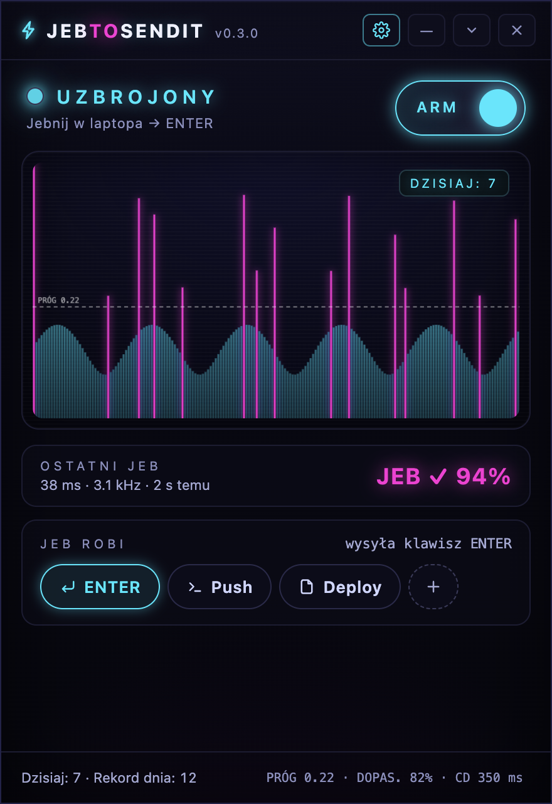

# ⚡ JebToSendIt

**JEB your laptop — send Enter, run a command, or launch a script.**

English · [Polski](README.pl.md)

A *JEB* is Polish for a solid whack. JebToSendIt listens for short microphone
impacts and triggers your chosen action. Calibration learns the impact's spectrum
and duration to distinguish it from speech. The app lives in the system tray.



## Get started

Download from [Releases](https://github.com/doctorspider42/JebToSendIt/releases/latest):

- **Windows 10/11:** run the portable x64 `.exe`.
- **macOS:** choose the `arm64` DMG for Apple Silicon or `x64` for Intel; drag the
  application into Applications. Release DMGs are signed and notarized when the
  signing secrets described in [release setup](docs/releases.md) are configured.

Grant microphone access. On macOS, sending Enter also needs **System Settings →
Privacy & Security → Accessibility**, and permission for **Automation → System
Events** when requested. Relaunch after changing system permissions if needed.

The main window shows only what matters while you work: ARM, the live scope, the
last JEB and a quick action picker. Everything else lives in the **Settings**
window (gear icon or tray menu).

1. Arm the detector using the ARM switch or tray menu.
2. In **Settings → Calibration**, calibrate with 2–3 impacts after the countdown.
3. In **Settings → Detection**, adjust threshold, spectrum match and cooldown by
   dragging or scrolling the knobs (arrow keys work too) and pick the audio input.
4. In **Settings → Actions**, define custom actions: a name plus a shell command
   or a script (file picker or absolute path); **Test** runs one right away. The
   built-in **Key** action sends Enter by default — you can change the key.
   Under **JEB DOES** in the main window, pick which action a JEB triggers.
5. See today's persistent count and your best daily count. Counts reset at local
   midnight; the record survives restarts. A new record shows an in-app message
   and system notification once per day. Turn off **Notify about a new daily
   record** to disable both; counting continues. Calibration and disarmed hits
   do not count. An accepted hit counts even if its action fails.

Commands run in PowerShell on Windows and zsh on macOS. Scripts support `.js`,
`.cjs`, `.mjs` (bundled Node), `.py` (Python), `.ps1` (PowerShell), `.sh` and `.zsh`.
Install the corresponding interpreter for non-JavaScript scripts. Scripts run
from their own folder. Commands use the app's working directory and environment.
Only one action runs at a time; additional hits still count but report a busy
error. Actions have a 30-second execution limit, and failures appear in the UI.

Use Hide to tuck the app into the tray; Quit exits it. The language (System,
Polski, English) is in **Settings → App**.
Settings and counters are stored locally in Electron's user data directory.

## Development and builds

Requires **Node.js 26**. The app uses Electron 45, electron-builder 26,
electron-store 12 and i18next 26.

```sh
nvm use
npm ci
npm start
npm run check
npm test
npm run smoke
```

```sh
npm run build:win  # Windows portable x64 (run on Windows)
npm run build:mac  # Apple Silicon + Intel DMG (run on macOS)
```

`build.ps1` / `build.sh` are convenience wrappers. See [release setup and
verification](docs/releases.md) for Apple signing, the local `zitter-notary`
Keychain profile, GitHub secrets and publishing. CI uses Node 26 and tests all
three operating systems; tagged releases publish Windows and macOS together.

The detector uses AudioWorklet for peaks, eight logarithmic spectrum bands,
cosine similarity and a short duration check. Keystrokes use persistent
PowerShell SendKeys on Windows and System Events via AppleScript on macOS.
The renderer is sandboxed, with context isolation and a narrow preload API.
Linux can run development tests; its Enter sender is not implemented.

## License

MIT
