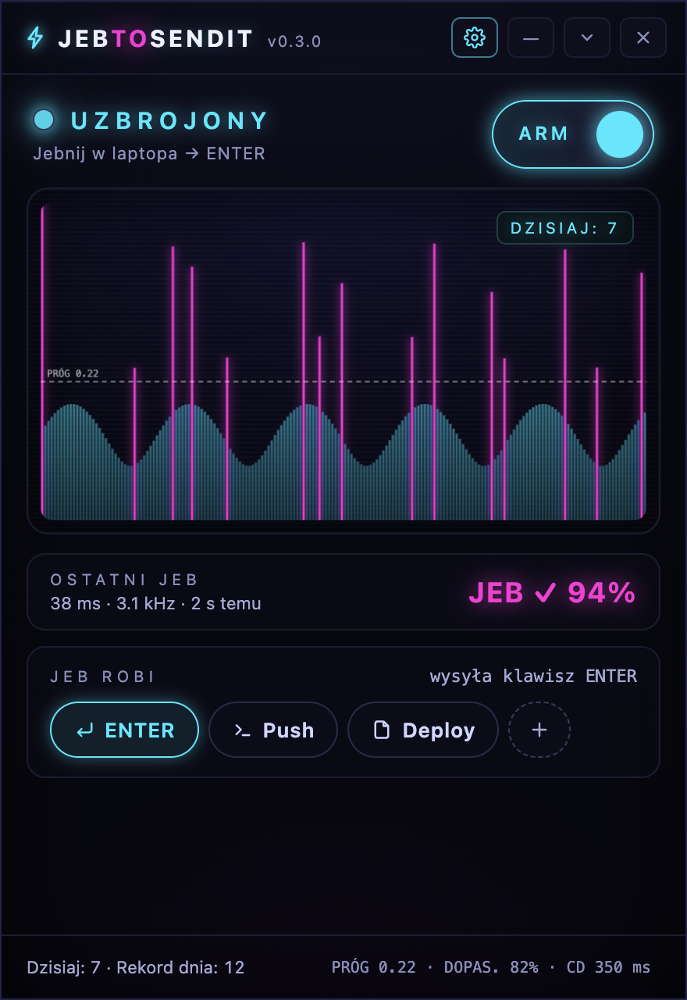

# ⚡ JebToSendIt

**Jebnij w laptopa — wyślij Enter, uruchom polecenie albo skrypt.**

[English](README.md) · Polski

Aplikacja nasłuchuje krótkich uderzeń przez mikrofon. Kalibracja uczy się widma
oraz długości jebnięcia i odróżnia je od mowy. Program działa w tle, w trayu.



## Start

Pobierz pliki z [Releases](https://github.com/doctorspider42/JebToSendIt/releases/latest):

- **Windows 10/11:** uruchom przenośny plik `.exe` x64.
- **macOS:** wybierz DMG `arm64` dla Apple Silicon albo `x64` dla Intela i przeciągnij
  aplikację do Applications. Podpisanie i notaryzacja wydań wymagają konfiguracji
  opisanej w [instrukcji pipeline](docs/releases.md).

Zezwól na mikrofon. W macOS wysyłanie Entera wymaga też **Ustawienia systemowe →
Prywatność i ochrona → Dostępność** oraz zgody w **Automatyzacja → System Events**,
gdy system o nią poprosi. Po zmianie uprawnień może być potrzebny restart aplikacji.

Okno główne pokazuje tylko to, co potrzebne w trakcie pracy: ARM, scope, ostatni
JEB i szybki wybór akcji. Cała reszta siedzi w oknie **Ustawienia** (zębatka albo
menu traya).

1. Uzbrój detektor przełącznikiem ARM lub z menu traya.
2. W **Ustawienia → Kalibracja** uruchom kalibrację i po odliczaniu jebnij 2–3 razy.
3. W **Ustawienia → Detekcja** ustaw próg, dopasowanie widma i cooldown, przeciągając
   pokrętła, kręcąc kółkiem lub strzałkami, i wybierz wejście audio.
4. W **Ustawienia → Akcje** zdefiniuj własne akcje: nazwa plus polecenie powłoki albo
   skrypt (wybór pliku lub pełna ścieżka); **Przetestuj** odpala ją od ręki. Wbudowana
   akcja **Klawisz** domyślnie wysyła Enter — klawisz można zmienić. W oknie głównym,
   w **JEB ROBI**, wybierasz, co odpala jebnięcie.
5. Licznik pokazuje dzisiejsze jebnięcia i rekord dnia. Stan przeżywa restart,
   a dzień zmienia się o lokalnej północy. Po pobiciu rekordu raz dziennie pojawia
   się komunikat w aplikacji i powiadomienie systemowe. Opcja **Powiadamiaj o nowym
   rekordzie dnia** wyłącza oba komunikaty, pozostawiając zliczanie. Kalibracja
   i rozbrojony detektor nie naliczają jebnięć. Błąd akcji nie cofa naliczenia.

Polecenia wykonują się w PowerShell na Windowsie lub zsh na macOS. Skrypty:
`.js`, `.cjs`, `.mjs` (wbudowany Node), `.py` (Python), `.ps1` (PowerShell), `.sh`
i `.zsh`. Poza JS wymagany jest zainstalowany interpreter. Skrypt działa ze swojego
katalogu; polecenie korzysta z katalogu roboczego i środowiska aplikacji. Wykonuje
się jedna akcja naraz, z limitem 30 sekund. Kolejne jebnięcie podczas wykonywania
akcji nadal się liczy, ale zgłasza zajętość. Błędy są widoczne w interfejsie.

Schowanie okna pozostawia program w trayu; Zamknij kończy działanie. Język
(Systemowy, Polski, English) zmienisz w **Ustawienia → Aplikacja**. Ustawienia i statystyki są lokalne, w katalogu danych użytkownika Electrona.

## Rozwój i budowanie

Wymagany **Node.js 26**. Zależności: Electron 45, electron-builder 26,
electron-store 12 i i18next 26.

```sh
nvm use
npm ci
npm start
npm run check
npm test
npm run smoke
```

```sh
npm run build:win  # portable EXE x64, na Windowsie
npm run build:mac  # DMG Apple Silicon + Intel, na macOS
```

Dostępne są też `build.ps1` i `build.sh`. [Instrukcja wydań](docs/releases.md)
opisuje podpisywanie certyfikatem Zittera, lokalny profil Keychain `zitter-notary`,
sekrety GitHuba, notaryzację i weryfikację. Pipeline używa Node 26 i testuje trzy
systemy; tag wersji publikuje wspólne wydanie Windows + macOS.

Detekcja korzysta z AudioWorklet, ośmiu pasm widma i porównania długości impulsu.
Enter wysyłany jest przez PowerShell SendKeys na Windowsie i AppleScript/System
Events na macOS. Renderer działa w sandboxie, z izolacją kontekstu i wąskim API
preload. Linux służy do testów; wysyłanie Entera nie jest tam zaimplementowane.

## Licencja

MIT
